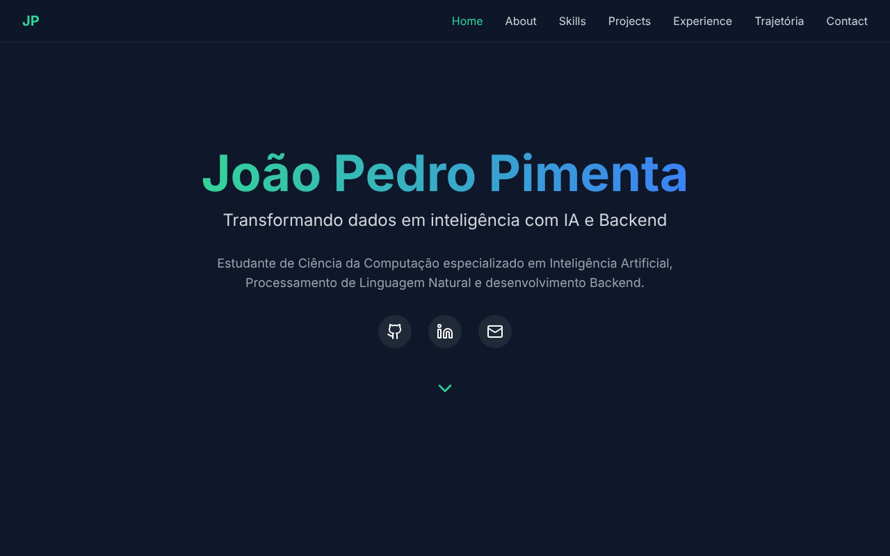
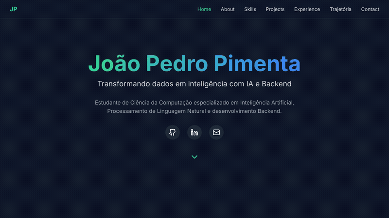

# Portfólio — João Pedro Pimenta

Meu portfólio pessoal, feito com **React, Vite e Tailwind CSS**, para apresentar minha trajetória acadêmica e profissional em **Inteligência Artificial, Backend e Processamento de Linguagem Natural**.

🚀 **No ar:** [portifolio-lowx27sxl-pimenta15s-projects.vercel.app](https://portifolio-lowx27sxl-pimenta15s-projects.vercel.app)



## Demonstração



## Seções

- **Home:** apresentação e links para GitHub, LinkedIn e e-mail
- **Sobre**
- **Habilidades**
- **Projetos**
- **Experiência**
- **Trajetória**
- **Contato**

## Como executar localmente

```bash
npm install
npm run dev       # servidor de desenvolvimento em http://localhost:5173
npm run build     # build de produção em dist/
```

## Tecnologias

- ⚡ [Vite](https://vitejs.dev/): build e servidor de desenvolvimento
- ⚛️ [React 19](https://react.dev/): interface
- 🎨 [Tailwind CSS](https://tailwindcss.com/): estilização responsiva
- 🎭 [Lucide React](https://lucide.dev/): ícones
- ▲ [Vercel](https://vercel.com/): hospedagem

---

Desenvolvido por [João Pedro Pimenta](https://www.linkedin.com/in/joao-pedro-pimenta/).
